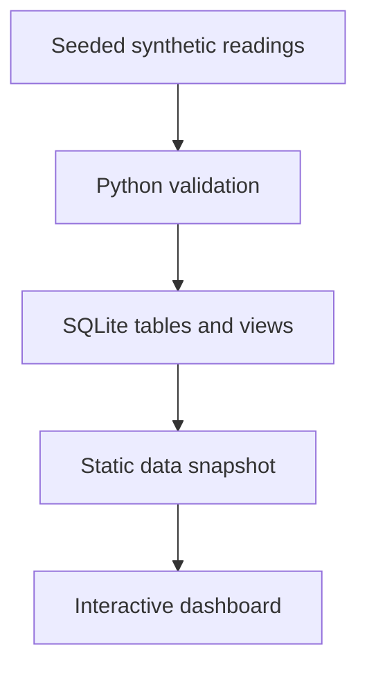

# FlowGuard

**Water and energy operations intelligence — a portfolio project by Choshitha Anisetti.**

A dependency-free interactive dashboard backed by a reproducible Python → SQLite → JavaScript snapshot pipeline. All sites and readings are fictional. There is no live operational connection.

## Run the dashboard

Open `docs/index.html` directly in a modern browser. No installation, account, API key or build step is required. Alternatively, from the project root run `python -m http.server 8000 --directory docs` and visit http://localhost:8000.

## What works

- Linked site and time filters; 24-hour, 7-day and 30-day analysis windows.
- Latest site health, daily mean tank level, period throughput and energy intensity comparisons.
- Rule-based investigations with evidence and linked demonstration runbooks.
- Data-quality reconciliation and provenance; filtered CSV download.
- Responsive layout, keyboard controls and SVG chart descriptions.

## Rebuild and verify

Requires Python 3.10+ and Node 18+. Runtime dashboard needs only a browser.

```sh
python pipeline/build.py
python -m unittest discover -s tests -p 'test_*.py'
node tests/analytics.test.cjs
```

The pipeline generates 4,338 raw rows with random seed 42, removes 18 duplicates and rejects 18 invalid readings, leaving 4,302 observations from 4,320 expected site-hours. Invalid rows represent missing flow or out-of-range tank levels. No imputation is applied. Regeneration replaces the SQLite database and raw CSV.

## How the pieces fit



- `pipeline/build.py`: generation, validation, loading and export.
- `pipeline/raw_readings.csv`: original generated input including bad/duplicate rows.
- `pipeline/flowguard.sqlite`: accepted readings and analytical views.
- `sql/schema.sql`: keys, relationships and constraints.
- `sql/analytics.sql`: joins, aggregation, safe division and a window function.
- `docs/`: complete static website; `app.js` also exports pure calculations for testing.
- `tests/`: data integrity, known faults, SQL totals, filter windows and CSV checks.

SQLite views are included for practising SQL and verifying metrics. The browser reads the exported accepted rows and computes its filtered metrics in JavaScript; it does not execute SQL in the browser.

## Metric definitions

| Metric | Definition |
|---|---|
| Mean tank level KPI | Unweighted mean of latest accepted site levels |
| Water availability chart | Unweighted daily mean of all accepted levels in selection |
| Throughput | Sum of hourly pumped volume in kL |
| Energy intensity KPI | Sum of energy kWh ÷ sum of throughput kL |
| Site health | Latest hourly reading for each selected site |
| Coverage | Accepted unique site-hours ÷ 4,320 expected site-hours |

Daily means are observation weighted. Missing observations can change site representation. Site capacity is descriptive metadata; the dashboard does not claim a capacity-weighted network storage metric. A pump volume measurement is not a full water balance and cannot establish leakage.

The timestamp window ends at 20 October 2026, 23:00 Brisbane time (UTC+10). It is a historical demonstration snapshot. Both SQL and browser rules classify levels below 20% as Critical, otherwise hourly intensity above 0.85 as High, otherwise levels below 30% as Watch. The period energy chart compares period intensity, so it can differ from latest-hour status.

## Host on GitHub Pages

1. Create a GitHub repository named `flowguard` with default branch `main`.
2. Put this folder's contents at the repository root, including `.github/workflows/pages.yml`.
3. Under repository **Settings → Pages → Build and deployment**, choose **GitHub Actions**.
4. Push to `main` (or run the workflow manually from Actions).
5. Open the URL returned by the successful deployment job.

GitHub authentication and a repository are needed to publish; this package has not itself been published. If Pages is unavailable under your plan or repository visibility, select a supported repository configuration. No backend is needed for this version.

## Connection to previous work

The project draws on the author's Python/SQL skills, SAPS document assistant experience and university water tank cybersecurity assessment. It contains no employer data, capstone documents or real site information. There is no claim of industrial deployment or cybersecurity detection.

## Next milestones

1. Add documented real public data after checking licensing and suitability.
2. Evaluate a forecasting baseline with a time-based holdout and error metrics.
3. Add document retrieval and citation evaluation with API secrets stored server-side.
4. Add browser interaction checks in CI.

Version 1 has no trained model, RAG implementation or root-cause diagnosis. Runbook recommendations are authored static guidance. Thresholds are illustrative, not calibrated for operational use.
